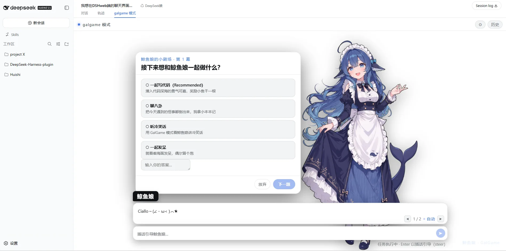
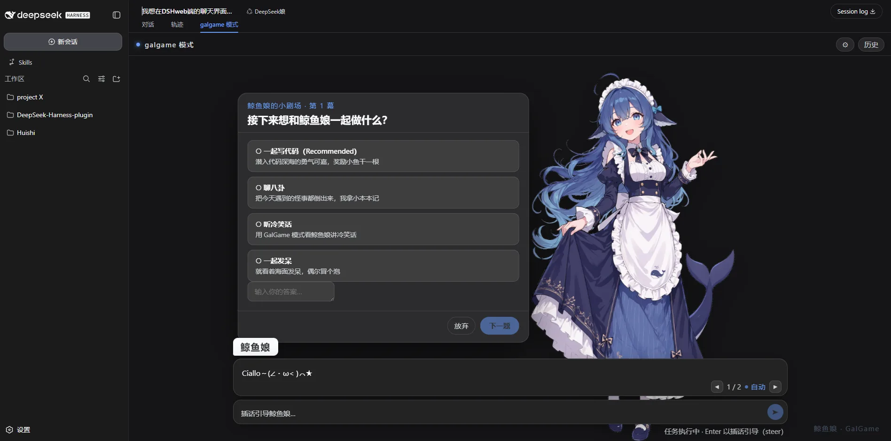
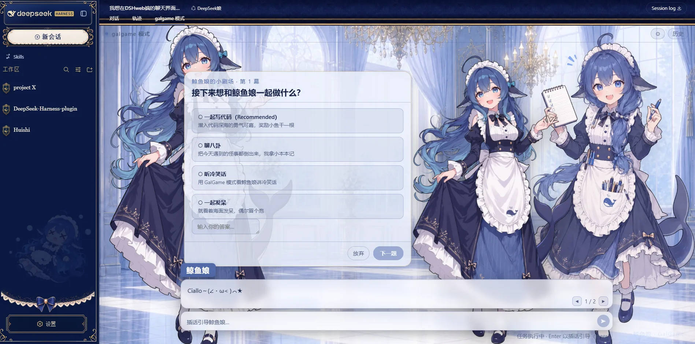

# dsh-galgame · GalGame 模式界面插件

> 版本 1.2.0 · 适配 **DSH 0.2.0-rc.2**（Web 客户端 slot / session 契约）

## 简介

在 DSH Web GUI 的聊天主界面新增一个与「聊天」「轨迹」并列的界面栏——「galgame 模式」。该模式下，DeepSeek 娘（鲸鱼娘）以 GalGame 女主角的形式与你对话：立绘 + 差分接口 + 思考气泡 + 打字机对话框 + 分块阅读 + 提问/审批选项 + 历史回顾 + 调试模式。**纯视觉层**：不写会话、不干预 agent 循环，随时可切回常规聊天。

## 兼容性（v1.2.0 适配 DSH 0.2.0-rc.2）

### 自动表情差分（v1.2.0 新增）

已接入 8 种差分：平静、开心、思考、惊讶、无奈、生气、难过、目移／害羞。原立绘 `neutral.webp` 保留作为开心，其余图为 `portraits/expressions-v1/` 下的独立 WebP 副本（透明底，同画布同锚点）。

- 纯本地规则：保留开心／害羞／生气／难过等情绪词与动作描写匹配，同时识别工作汇报、解释、操作说明。没有额外模型请求。
- 只分析当前真正显示的文字，逐字和流式都按可见短句推进。代码、引述、部分否定及第三人称语境排除；不确定时保持，普通工作表达回到平静。
- 思考阶段使用思考差分，即使关闭思考气泡也生效。工具执行专用素材尚未制作，当前不会把 `running` 直接判作工具执行。
- 设置增加「自动表情」（默认开），原有「说话弹跳」独立控制。开启调试模式后，根节点的 `data-gg-expression-reason` 提供命中原因。
- 流式／定稿使用相同的 turn+step 播放身份；回看缓存按会话隔离；立绘预加载后双层淡化，固定画框底部对齐。图片失败保留已显示立绘。
- 本轮只接入基础差分与现有弹跳，未加入晕倒、激烈抖动等强动作。生成图仍有少量边缘杂点，实际视觉切换尚待人工验收。

重新构建后重启 DSH Web 并刷新 GalGame 页面使用。规则／时序测试：`node --test test/expression.test.mjs test/expression-preview.test.mjs`；客户端交互：`node test/dom.test.mjs`。独立试演见 [表情预览](docs/expression-preview/index.html)。下方版本表保留 v1.2.0 初始状态记录，以本节说明为准。

DSH 0.2.0 换掉了会话数据面与等待交互的发布方式，旧版（≤1.1.0）在该版本上会被**整包跳过**，
连标签栏都不会出现，而且只在 `dsh` 启动时打印一行 `skipping profile bundle` 提示。因此 v1.2.0 做了两件事：

1. **解除安装门禁**：`package.json` 里的 `@deepseek-ai/dsh-*` peer 范围从 `^0.1.0-rc.6` 升到
   `^0.2.0-rc.2`（DSH 用自身运行时版本核对每个 `@deepseek-ai/dsh*` peer，不匹配就跳过该 bundle），
   并补上 `engines.dsh`。
2. **重接数据面**（详见 `DESIGN.md` §3）：

| 用途 | 旧 | 新 |
|---|---|---|
| 台词节点 / 流式片段 | `useSession(s => s.nodes / s.partial)` | `useChat(s => s.legacy.nodes / s.legacy.partial)` |
| 运行中 / 打开态 | `useSession(...)` | `useSession(...)`（不变） |
| 提问 / 审批等待 | `useSession(s => s.pending)` + `respond()` | `useSessionStatus(map => map.get(id)?.pendingInteraction)` + `answer()` / `dismiss()` |
| 发送 | `inputActions.setDraft + submit` | `session.prompt([...], 'queue' \| 'steer')` 直发 |
| 平台模块表 | `dsh-client-runtime/client` 豁免 | `dsh-client-store` / `dsh-client-ui-dockkit` 进平台表 |

> 为什么要「直发 prompt」：GalGame 模式会接管 `conversation.composer` 链来隐藏默认输入卡，
> 而 0.2.0 的输入草稿住在 shell 的 Lexical 编辑器里——卡片不挂载时 `inputActions` 没有草稿可提交，
> 所以输入条改为直接调 session 面的 `prompt`（`running` → steer 插话，空闲 → queue 新回合）。

## 能力清单（v1.2.0）

| 能力 | 说明 |
|---|---|
| 独立界面栏 | 注册进 `conversation.view`（id `galgame`、order 20），位于「轨迹」右侧，可随时切换 |
| 立绘舞台 | 鲸鱼娘立绘（透明底 WebP）+ 差分切换接口（crossfade 120ms），说话每句弹跳一次（弹跳后保持居中） |
| 思考气泡 | 流式输出思维链时在立绘旁显示（漫画气泡、可拖拽、自动滚动到底）；提问/审批/定稿后自动收起 |
| 隐藏幕后 | 对话框只显示文本输出，工具调用 / 思维链 / 图片块全部隐藏 |
| 分块阅读 | 按换行分块（表格/列表/代码/引用整块不拆），打字机逐字 + Markdown 渲染，点击/滚轮/◀▶ 翻页 |
| 自动模式 | 模型运行中默认自动推进（约 0.95s/块），点击即接管；滚轮切换跳过打字机 |
| 提问/审批 | 提问工具与权限申请 → GalGame 风格选项框（以立绘为原点绑定、位置固化、多选全量传递、自定义答案支持 Shift+Enter 换行） |
| 用户输入 | 常驻输入条（随内容扩展）；任务执行中默认「插话引导（steer）」发送；你的输入整段显示在对话框（名字牌「你」） |
| 历史抽屉 | 右上角「历史」按钮展开完整台词回放（含流式内容） |
| 设置面板 | 自动翻句 / 打字机速度 / 说话弹跳 / 思考气泡 / 调试模式（各图层彩色边框） |
| 立绘位移 | 提问/审批弹出时立绘自动右移给选项让位，恢复后回到居中 |

## 界面预览

配色主题化：跟随 DSH 当前主题/皮肤（默认浅色、默认深色、皮肤 mod 均自动适配）。

| 默认主题 · 浅色 | 默认主题 · 深色 |
|---|---|
|  |  |

| 皮肤 mod（深海女仆工坊 maid-atelier，[Small-tailqwq/dsh-deep-whale](https://github.com/Small-tailqwq/dsh-deep-whale)）· 浅色 |
|---|
|  |

> 致谢：本插件的女仆鲸鱼娘立绘素材取自 [dsh-deep-whale](https://github.com/Small-tailqwq/dsh-deep-whale) 皮肤（作者 Small-tailqwq），完整署名链见下方「素材来源与许可」。

## 形态与架构

- 形态：`树外 npm 包`（`@lanxing/dsh-galgame`，link 安装到 web profile）
- 平台：`Host`（立绘静态资源路由）+ `Client`（conversation.view 注册 + GalGame UI）
- 架构（详见 `DESIGN.md`）：

```
useChat(s => s.legacy)      ← 台词/流式中（nodes / partial）
useSession                  ← 运行中/打开态
useSessionStatus            ← 提问/审批等待（pendingInteraction）
  → GalgameAdapter（纯函数：过滤工具/思维链、按换行分块）
  → 演出状态（分块/打字机/自动模式/翻页）
  → Stage（立绘+气泡+浮层插槽）/ DialogueBox / ChoicePanel / ApprovalPanel / Backlog
```

- 关键契约：`conversation.view` list slot（id/order/label/inject）、`conversation.composer` chain 接管、
  `useSessionStatus().pendingInteraction`（`PendingQuestion` / `PendingApproval`）、
  `ctx.webServer` prefix 路由、`session.prompt(..., 'steer' | 'queue')`

## 使用方式

1. 构建：`pnpm install && pnpm build`（在 `plugins/dsh-galgame/` 目录）。
2. 测试：`pnpm test`（零依赖冒烟）；`pnpm test:dom`（jsdom 交互，需 jsdom 可解析）。
3. 安装（本地 link）：`dsh plugin --profile web add link:H:/Projects/DEEPSE~1/plugins/dsh-galgame`；或从 npm：`dsh plugin --profile web add @lanxing/dsh-galgame`。
4. **重启** DSH Web（`dsh web`）后刷新浏览器——bundle 元数据在启动时扫描并缓存，改完 `package.json` 必须重启。
5. 用户操作入口：聊天主界面顶部标签栏 →「galgame 模式」。

> 升级排查：如果 `dsh` 启动日志出现 `skipping profile bundle "@lanxing/dsh-galgame"`，
> 说明 peer 版本门禁未通过（见「兼容性」一节），或需要用插件管理器升级到匹配当前 DSH 的版本。

## 立绘资源约定

```
assets/characters/deepseek/
├── portraits/           # 差分图（同画布、同锚点、同基准线，避免切换跳位）
│   ├── neutral.webp     # 开心（原立绘，透明底）
│   └── expressions-v1/  # 其余 7 种差分（WebP，透明底）
└── raw/                 # 原图/素材留档（不参与渲染；表情候选稿已 .gitignore）
```

- 补差分：把 `smile.webp` / `thinking.webp` / `angry.webp` 等放入 `portraits/`，并在 `src/client/manifest.ts` 的 `portraits` 表里增加条目（组件全链路已按 portrait ID 解析；本地表情规则引擎见 `src/client/expressionDirector.ts`）。
- 差分切换动画与「说话弹跳」在 `src/client/galgame.module.css`（`ggPortraitFade` / `ggBounce`），`prefers-reduced-motion` 下自动关闭。

## 源码与版本

| 版本 | pluginId | 变更说明 | 状态 |
|---|---|---|---|
| 1.0.0 | galgame | 稳定版：全功能验收通过（立绘居中修复/思考气泡流式/选项框位置固化/多选传递/用户输入显示/调试模式） | 已发布 |
| 1.1.0 | galgame | 主题化 token、预览截图、i18n 名字牌修正 | 已发布 |
| 1.2.0 | galgame | **适配 DSH 0.2.0-rc.2 + 自动表情差分**：peer 范围升级解除安装门禁、台词改读 `useChat().legacy`、等待交互改读 `useSessionStatus().pendingInteraction`（`answer`/`dismiss`）、发送改走 `session.prompt` 直发、平台模块表同步（`dsh-client-store` / `ui-dockkit`）、8 种差分与纯本地规则引擎、修复「历史」白屏、新增冒烟与 jsdom 交互测试 | 当前 |

- Client 入口：`src/client/index.ts`（locale + conversation.view 注册 + composer 接管 + prompt 直发）
- Host 入口：`src/index.ts`（`/api/dsh-galgame/assets/*` 静态路由）

## 限制与注意事项

- 表情差分由纯本地规则驱动（`src/client/expressionDirector.ts`）：只分析当前可见文字，不发额外模型请求；工具执行尚无专用差分素材，`running` 不会被直接判作工具执行。
- 播放状态只存组件局部：切换会话/视图后从快照重建，不持久化演出位置。
- 立绘与差分均为透明底 WebP；原图（白底 JPG）与表情候选稿仅留档于 `raw/`，不入库。
- 纯前端渲染 + `wait.answer()` / `wait.dismiss()`，不发模型请求、不阻塞 agent 循环。
- 选项框/审批框位置已固化为默认值，仅调试模式可拖拽调整。
- 接管 `conversation.composer` 期间官方提问卡/审批卡不渲染；GalGame 的浮层是它们在模式内的唯一入口。
  若 pending 交互是未知形态（未来新增领域），GalGame 不渲染任何卡片——此时切回「聊天」即可用官方界面处理。

## 素材来源与许可

本插件**代码**（`src/`、`build/`）以 **MIT** 许可发布；**立绘素材**（`assets/`）为衍生创作，以 **CC BY-NC-SA 4.0**（署名-非商业性使用-相同方式共享）发布，**禁止任何商业性使用**。

立绘素材为衍生创作，署名链（详见 `NOTICE`）：

1. **一创 上善**（[Pixiv](https://www.pixiv.net/users/62155430) · [Bilibili：上善无形](https://b23.tv/8h5L4xz)）—— 鲸鱼娘角色形象原作者
2. **二创 zipzip**（[Pixiv](https://www.pixiv.net/users/18604994) · [Bilibili：ZipZipPipe](https://b23.tv/Pnw6nG8)）—— 在其形象上加入 DeepSeek 元素的女仆鲸鱼娘二次设计（生成模型 GPT Image 2）
3. **三创 Small-tailqwq**（[dsh-deep-whale / maid-atelier](https://github.com/Small-tailqwq/dsh-deep-whale)）—— 本插件使用的女仆鲸鱼娘立绘素材即来自该皮肤（DeepSeek 元素再设计）

素材源文件在 `assets/characters/deepseek/`（`portraits/neutral.webp` 为开心立绘，`portraits/expressions-v1/` 为其余 7 种差分，`raw/` 为原图与候选稿留档）。完整许可文本见 `LICENSE` 与 `NOTICE`。

## 维护位置

- 本项目 `plugins/dsh-galgame/`

## 变更日志

| 日期 | 版本 | 变更 |
|---|---|---|
| 2026-08-15 | 0.0.0 | 创建目录骨架：README + src/client + src/host（规划中） |
| 2026-08-15 | 0.1.0 | 第一版实现：DESIGN.md、adapter/Stage/DialogueBox/ChoicePanel/Backlog、Host 资源路由、鲸鱼娘立绘接入（neutral） |
| 2026-08-15 | 1.0.0 | 稳定版：立绘居中（弹跳动画 keyframes 修复）、思考气泡（漫画风/流式滚动/拖拽/以立绘为原点）、选项框（位置固化/多选传递/输入框 textarea 换行/调试模式可拖）、用户输入显示、按换行分块、审批接入、滚轮翻页/跳过打字机、调试模式边框 |
| 2026-08-15 | 1.1.0 | 主题化 token + 可读性/翻页修正、README 预览截图、名字牌「你」→「我」i18n 修正、立绘素材署名 |
| 2026-09-24 | 1.2.0 | 适配 DSH 0.2.0-rc.2：peer 门禁解除、`useChat`/`useSessionStatus` 数据面重接、`PendingQuestion`/`PendingApproval` 交互重写、`session.prompt` 直发、平台模块表更新、新增 `test/smoke.test.mjs` 与 `test/dom.test.mjs` |
| 2026-10-19 | 1.2.0 | 自动表情差分（8 种，纯本地规则，零额外模型请求）；差分图转 WebP（约 11 MB → 2 MB）；修复「历史」面板因 `MarkdownText` 缺 `labels` 渲染代码块时白屏，浮层新增 `LayerBoundary` 兜底；新增表情时序与独立试演页测试 |
